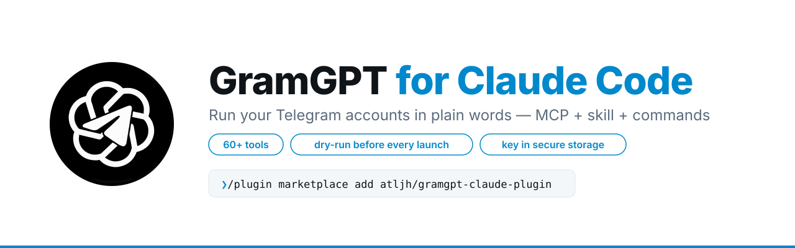
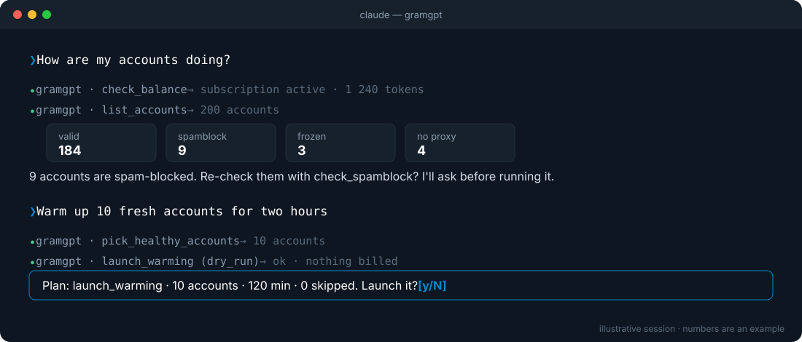

<p align="center">
  <picture>
    <source media="(prefers-color-scheme: dark)" srcset="assets/banner-dark.svg">
    
  </picture>
</p>

<p align="center">
  <a href="https://github.com/atljh/gramgpt-claude-plugin/actions/workflows/validate.yml"></a>
  <a href="https://github.com/atljh/gramgpt-claude-plugin/releases"></a>
  <a href="https://code.claude.com/docs/en/plugins"></a>
  <a href="https://gramgpt.io/api/v1/docs/"></a>
  <a href="LICENSE"></a>
</p>

<p align="center">
  <b>Run your <a href="https://gramgpt.io">GramGPT</a> Telegram accounts from Claude Code — in plain words.</b><br>
  Check account health, run parsers and checkers, warm accounts up, launch modules, follow tasks.
</p>

<p align="center">
  <a href="#install">Install</a> ·
  <a href="#what-to-ask">What to ask</a> ·
  <a href="#commands">Commands</a> ·
  <a href="#safety">Safety</a> ·
  <a href="skills/gramgpt/references/tools/README.md">Tool reference</a> ·
  <a href="#other-mcp-clients">Cursor / VS Code</a> ·
  <a href="#по-русски">По-русски</a>
</p>

<p align="center">
  
</p>

## Install

You need a GramGPT API key: **gramgpt.io → Settings → API keys**.

**Option A — terminal, one line**

```bash
claude plugin install gramgpt --marketplace atljh/gramgpt-claude-plugin
```

Then open Claude Code and run `/plugin configure gramgpt@gramgpt` — paste the key there.

**Option B — inside Claude Code, two commands one after another**

```text
/plugin marketplace add atljh/gramgpt-claude-plugin
```

```text
/plugin install gramgpt@gramgpt
```

The second command asks for the key. If you go through the `/plugin` menu instead,
paste **only** `atljh/gramgpt-claude-plugin` into the *Add Marketplace* field.

Restart Claude Code — the `gramgpt` tools show up in every project. The key is kept in
Claude Code's secure storage, never in a file.

<details>
<summary>Update, change the key, remove</summary>

| to | run |
|---|---|
| update | `/plugin marketplace update gramgpt` |
| new key | `/plugin configure gramgpt@gramgpt` |
| remove | `/plugin uninstall gramgpt@gramgpt` |

Connected GramGPT before with `claude mcp add`? Remove that one
(`claude mcp remove gramgpt -s user`) so the tools don't show up twice.
</details>

## What to ask

| You say | Claude does |
|---|---|
| *How are my accounts doing?* | balance, accounts by status, what needs attention |
| *Warm up 10 fresh accounts for two hours* | picks healthy accounts, checks GGR, dry-runs `launch_warming`, asks, starts |
| *Find crypto channels with open comments, drop the dead ones* | `launch_parsing` → `launch_check_channels` → shows the list |
| *Start NeuroCommenting on these channels with the "crypto" project* | reads the module's config reference, dry-run, plan, your yes, launch |
| *What's unread in the inbox of accounts 12 and 15?* | `read_inbox`, transcribes voice notes, drafts replies for you to approve |
| *Follow task 3f2c… and tell me when it's done* | polls progress, summarises results or the failure reason |

## Commands

| command | what it does |
|---|---|
| `/gramgpt:status` | balance, account health, running tasks — read-only |
| `/gramgpt:launch <what>` | pick accounts → dry-run → plan → your yes → launch |
| `/gramgpt:task <task_id>` | follow a task to the end and summarise it |

## Safety

- **Dry-run first.** Every launch is checked with `dry_run` (free) and shown as a plan before it starts.
- **Asks before anything irreversible** — deleting, cancelling, buying, or sending in your name.
- **Your key stays yours** — asked once at install, kept in secure storage, sent only to `gramgpt.io`.
- **Account-friendly defaults** — prefers warmed accounts, checks GGR before heavy tasks, keeps module defaults.

The GramGPT MCP server also sends these rules on connect, so any MCP client follows them.

## What's inside

```
.claude-plugin/            plugin + marketplace manifests, icon
.mcp.json                  https://gramgpt.io/mcp/ with your key
skills/gramgpt/
  SKILL.md                 rules, tool map, REST-only endpoints
  references/recipes.md    tested call chains
  references/tools/        one page per tool — inputs, config keys, defaults, limits
commands/                  /gramgpt:status · /gramgpt:launch · /gramgpt:task
scripts/gen_reference.py   rebuilds references/tools from the public OpenAPI (stdlib only)
```

The [tool reference](skills/gramgpt/references/tools/README.md) is generated from the live
API schema and refreshed by CI every Monday, so new tools and options show up on their own.

## Other MCP clients

Server `https://gramgpt.io/mcp/`, header `Authorization: Bearer ggk_live_…`.

[](https://cursor.com/en/install-mcp?name=gramgpt&config=eyJ1cmwiOiJodHRwczovL2dyYW1ncHQuaW8vbWNwLyIsImhlYWRlcnMiOnsiQXV0aG9yaXphdGlvbiI6IkJlYXJlciBnZ2tfbGl2ZV9ZT1VSX0tFWSJ9fQ%3D%3D)
— then replace `ggk_live_YOUR_KEY` with your key in Cursor's MCP settings.

<details>
<summary>VS Code (<code>.vscode/mcp.json</code>) — asks for the key</summary>

```json
{
  "servers": {
    "gramgpt": {
      "type": "http",
      "url": "https://gramgpt.io/mcp/",
      "headers": { "Authorization": "Bearer ${input:gramgpt_key}" }
    }
  },
  "inputs": [
    { "type": "promptString", "id": "gramgpt_key", "description": "GramGPT API key", "password": true }
  ]
}
```
</details>

<details>
<summary>Claude Desktop, n8n and others</summary>

Configs for every client are in the [API docs](https://gramgpt.io/api/v1/docs/) → MCP.
</details>

## По-русски

Плагин подключает Claude Code к вашему кабинету GramGPT: все инструменты через MCP, скилл с
правилами и справочником, команды `/gramgpt:status`, `/gramgpt:launch`, `/gramgpt:task`.

Ключ: **gramgpt.io → Настройки → API-ключи**.

**Вариант А — в терминале одной строкой:**

```bash
claude plugin install gramgpt --marketplace atljh/gramgpt-claude-plugin
```

Потом в Claude Code: `/plugin configure gramgpt@gramgpt` — вставьте ключ.

**Вариант Б — в Claude Code, две команды по очереди:**

```text
/plugin marketplace add atljh/gramgpt-claude-plugin
```

```text
/plugin install gramgpt@gramgpt
```

Вторая спросит ключ. Через меню `/plugin` в поле *Add Marketplace* вставляйте **только**
`atljh/gramgpt-claude-plugin`. Перезапустите Claude Code. Ключ хранится в защищённом
хранилище. Перед каждым запуском Claude делает dry-run и спрашивает подтверждение, перед
удалением, покупкой или отправкой от вашего имени тоже.

## Links

[API & MCP docs](https://gramgpt.io/api/v1/docs/) ·
[API changelog](https://gramgpt.io/api/v1/changelog/) ·
[Changelog](CHANGELOG.md) ·
[Security](SECURITY.md) ·
[Privacy](https://gramgpt.io/privacy)
